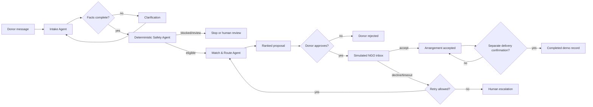

# AnnaOps

AnnaOps is a functional, local-first hackathon demonstration of surplus-food donation coordination. It turns a donor message into a validated offer, applies deterministic demo safety rules, ranks fictional receivers, requires explicit donor approval, simulates receiver responses, replans failed attempts, and keeps a durable audit trail.

> **Important:** Every NGO, coordinate, dispatch, response, and delivery confirmation in this repository is synthetic. AnnaOps does not certify food safety and is not connected to a real NGO, courier, or delivery system.

## What is included

- FastAPI backend and responsive Agent Operations dashboard
- Live persisted workflow monitor with per-stage status, timing, evidence, fallbacks, and human-control gates
- Interactive Judge Lab that launches five real, synthetic workflow scenarios through the same API used by donor intake
- LangGraph workflow with distinct intake, safety, and match/route nodes
- Persisted workflow coordinator that reads durable state and runs only the next permitted LangGraph node
- Bounded structured-output agent runtime with validated backend-owned tool calls
- Separate dispatch agent for approval, simulated receiver response, retries, and escalation
- Pydantic validation and explicit workflow states
- SQLite persistence for offers, safety assessments, match runs, approvals, attempts, audit events, outcomes, agent executions, action idempotency keys, and atomic creation reservations
- 12 fictional receiver profiles with capacity, category, availability, operating-hour, and minimum-quantity constraints
- Optional Gemini structured extraction and agent reasoning, plus optional OSRM routing
- Labelled deterministic extraction and straight-line routing fallbacks
- CSV donation records carrying a synthetic-data disclaimer
- Automated agent, API, failure-path, persistence, and end-to-end tests

## Quick start (Windows PowerShell)

Python 3.11+ is recommended.

```powershell
python -m venv .venv
.\.venv\Scripts\Activate.ps1
python -m pip install -r requirements.txt
python -m annaops.seed --with-scenarios
python -m uvicorn annaops.main:app --reload --port 8000
```

Open [http://127.0.0.1:8000](http://127.0.0.1:8000). API documentation is available at [http://127.0.0.1:8000/docs](http://127.0.0.1:8000/docs).

If `python` is not on `PATH`, use the full path to a Python 3.11+ executable for the first two commands; after activation, use `.\.venv\Scripts\python.exe`.

## Configure integrations

Copy `.env.example` to `.env`, then load those values into the process environment before starting the server. Uvicorn can do this directly:

```powershell
Copy-Item .env.example .env
.\.venv\Scripts\python.exe -m uvicorn annaops.main:app --env-file .env --port 8000
```

AnnaOps uses Gemini through Google's OpenAI-compatible `POST /chat/completions` endpoint:

- `ANNAOPS_GEMINI_API_KEY`: Gemini API key created in Google AI Studio
- `ANNAOPS_GEMINI_BASE_URL`: defaults to `https://generativelanguage.googleapis.com/v1beta/openai`
- `ANNAOPS_GEMINI_MODEL`: defaults to `gemini-3.8-flash` when a Gemini key is present

The older `ANNAOPS_LLM_API_KEY`, `ANNAOPS_LLM_BASE_URL`, and `ANNAOPS_LLM_MODEL` variables remain accepted as generic OpenAI-compatible aliases, but Gemini variables take precedence.

If the key or model is absent, intake uses a limited deterministic parser and labels the result `deterministic_demo`. If a configured model fails or returns malformed data, the parser preserves any facts it can validate, labels the source `llm_error`, and asks the user to confirm them. No fallback is presented as an LLM result.

When configured, the model is used for two tasks where language reasoning adds value:

1. Structured multi-item intake extraction and targeted clarification wording.
2. Receiver recommendation after inspecting live database and authoritative matching tool results.

The model never writes workflow state directly. Pydantic validates its output, the bounded runtime permits only registered tools, and backend code validates the final action against the current eligible receiver set. Safety, arithmetic, eligibility, transitions, idempotency, approval, and persistence remain deterministic.

Set `ANNAOPS_ROUTING_BASE_URL` to an OSRM-compatible service root to enable road estimates. Without it—or if it fails—the matcher reports either an unverified straight-line distance with no ETA, or `unavailable` when coordinates are missing.

Other settings:

| Variable | Default | Purpose |
| --- | --- | --- |
| `ANNAOPS_DATABASE_PATH` | `data/annaops.db` | SQLite database file |
| `ANNAOPS_TIMEZONE` | `Asia/Kolkata` | Local input/display timezone |
| `ANNAOPS_DEMO_MODE` | `true` | Marks created records synthetic |
| `ANNAOPS_MAX_DISPATCH_ATTEMPTS` | `2` | Escalation retry ceiling |
| `ANNAOPS_ESCALATION_WINDOW_MINUTES` | `30` | Escalate when too little collection time remains |
| `ANNAOPS_LLM_TIMEOUT_SECONDS` | `20` | Per-call model timeout |
| `ANNAOPS_AGENT_MAX_ITERATIONS` | `3` | Hard model/tool loop ceiling |

Never commit a populated `.env` file.

## Initialize and seed

The server automatically creates the schema and idempotently seeds the 12 fictional NGO profiles at startup.

```powershell
# Profiles only
.\.venv\Scripts\python.exe -m annaops.seed

# Profiles plus a complete offer, an incomplete offer, and a scripted safety block
.\.venv\Scripts\python.exe -m annaops.seed --with-scenarios
```

Each scenario is explicitly marked synthetic. Running `--with-scenarios` repeatedly creates additional offers by design; profiles remain idempotent.

## Tests

```powershell
.\.venv\Scripts\python.exe -m pytest -q
```

Tests use temporary SQLite databases, mocked/unavailable external integrations, and dynamic future timestamps. No API credit or internet connection is required.

Coverage includes extraction validation, missing and contradictory facts, all safety verdicts, category and capacity exclusion, matching and ranking, routing fallback, configured-LLM failure, donor approval enforcement, rejection and timeout replanning, retry escalation, action idempotency, role gates, audit events, CSV export, persistence after app restart, database constraints, and complete success/rejected-first-receiver workflows.

Agentic tests are separated from live-provider claims. `tests/test_agentic_runtime.py` uses an HTTP mock to prove the configured adapter sends a real chat-completions request and validates the returned structure, plus an injectable mocked model to prove bounded tool selection, tool-result feedback, invalid-action rejection, safe deterministic fallback, attempted-receiver exclusion, observability persistence, and UI mode labelling. These tests do not claim that a live provider was used. A live provider can be exercised by supplying the three LLM environment variables and running the normal workflow; no credential is required for the default test suite.

Creation idempotency is also exercised concurrently: multiple requests with the same key and message resolve to one persisted donation, while reusing a key for different content is rejected. A different key deliberately permits a genuinely new donation, even when its donor message is identical.

## Architecture



The immediate intake-to-proposal path is compiled as a typed LangGraph. A coordinator node reads the current persisted status and selects intake, safety, matching, or a durable pause. Human approval and NGO response are explicit SQLite states and API actions. Page refreshes and process restarts are therefore safe without pretending a long-running in-memory graph survived.

### Agent responsibilities

1. **Intake Agent** extracts only supplied facts, validates the schema, records explicit and inferred fields, and requests targeted clarification.
2. **Safety Agent** applies versioned Python rules. Missing or unrecognized storage is never silently approved; an LLM cannot override a block.
3. **Match & Route Agent** applies hard eligibility constraints before explainable scoring and records every receiver exclusion.
4. **Dispatch Agent** enforces approval, de-duplicates actions, simulates responses, excludes attempted receivers, caps retries, and keeps acceptance distinct from delivery.

### Registered agent tools

The receiver advisor can request only these backend-owned tools:

- `retrieve_receiver_profiles` — reads current capacity, availability, accepted categories, quantity limits, and operating hours.
- `inspect_previous_attempts` — reads persisted attempts and receiver responses for this donation.
- `run_eligibility_and_scoring` — applies authoritative eligibility, route estimation, exclusions, and scoring.

The runtime validates tool names and arguments, returns real results to the next bounded model turn, and rejects a final receiver outside the authoritative eligible set. If the provider fails, returns malformed JSON, requests an unknown tool, exceeds the iteration limit, or proposes a forbidden action, AnnaOps records the failure and uses an honestly labelled deterministic fallback.

## API

The principal endpoints are:

- `POST /api/donations`
- `GET /api/donations`
- `GET /api/donations/{id}`
- `GET /api/donations/{id}/workflow`
- `GET /api/donations/{id}/agent-executions`
- `POST /api/donations/{id}/clarify`
- `POST /api/donations/{id}/approve`
- `POST /api/donations/{id}/reject`
- `POST /api/donations/{id}/ngo-response`
- `POST /api/donations/{id}/delivery-confirmation`
- `POST /api/donations/{id}/escalate`
- `GET /api/donations/{id}/audit`
- `GET /api/donations/{id}/record.csv`
- `POST /api/demo/scenarios/{complete|missing|rejection|safety|escalation}`
- `GET /api/health`

Mutating bodies accept an optional `idempotency_key`. Donation creation reserves that key and creates the record in one SQLite `BEGIN IMMEDIATE` transaction, so concurrent retries cannot create duplicate records. Replaying the same key with the same message returns the original donation; replaying it with different content returns a validation error. The local demo also applies actor-label role gates (`donor`, `ngo`, or `coordinator`) to catch accidental misuse. These labels are **not authentication** and must be replaced with real identity, authorization, CSRF protection, rate limiting, and deployment controls before any non-local use.

## Judge demonstration

Start the service, open the dashboard, and use the five launchers in **Interactive Judge Lab**. Each creates a durable synthetic record and immediately opens its real workflow evidence; the cards are not scripted animations.

1. **A — Complete lifecycle:** inspect extraction, safety, ranked receivers, exclusions, and route limitation; approve; simulate acceptance; then record the separate delivery confirmation.
2. **B — Missing information:** inspect explicit and missing fields, submit clarification, and watch validation, safety, and matching resume on the same record.
3. **C — Rejection & replan:** approve the first proposal, simulate a decline, and show that the attempted receiver is excluded, replanning completes, and the replacement requires fresh donor approval.
4. **D — Safety review:** show the deterministic review verdict and confirm that matching and dispatch stay blocked.
5. **E — Retry exhaustion:** approve and fail two simulated attempts to demonstrate the bounded retry policy and human escalation.

For every path, the **Agent Workflow Monitor** and donation drawer are projections of persisted facts, match runs, approvals, attempts, and audit events. They show stage inputs and outputs, elapsed time where available, missing or conflicting facts, safety reasoning, scoring components, all receiver exclusions, integration fallbacks, and explicit human gates.

## Limitations

- The included safety rules are deliberately conservative demo rules, not validated legal or regulatory thresholds. Production criteria require qualified local review.
- NGOs and coordinates are fictional. Capacity and availability are synthetic database values.
- Receiver messaging, timeout scheduling, collection, and delivery confirmation are user-driven simulations.
- The deterministic parser recognizes a narrow set of foods, units, storage phrases, and ISO-8601 timestamps. Configure an LLM for broader language coverage.
- The deterministic parser preserves multiple explicit `quantity + unit + food` groups as itemized facts. Mixed measurement units are not summed or sent to automatic matching; they require human review.
- OSRM is optional and no public routing service is enabled by default.
- SQLite is suitable for a local demo, not a horizontally scaled deployment without additional coordination.
- Authentication is not implemented. Actor-label role gates are only guardrails for the local UI.
- Automatic background timeout jobs and production observability are not included.

## Troubleshooting

- **`ZoneInfoNotFoundError` on Windows:** reinstall dependencies; `tzdata` is pinned in `requirements.txt`.
- **Offer asks for clarification unexpectedly:** include quantity/unit, food, ISO-8601 preparation and pickup timestamps, storage, and a location. Coordinates are optional but needed for route distance.
- **No receivers are eligible:** inspect the exclusion reasons for capacity, category, operating hours, availability, minimum quantity, or previously attempted IDs.
- **LLM is labelled `llm_error`:** verify all three LLM variables and provider access. The workflow fails safely into confirmation rather than fabricating output.
- **Routing says straight-line fallback:** configure a reachable OSRM base URL and supply donor coordinates.
- **State transition returns HTTP 409:** refresh the record; actions are permitted only from the displayed workflow state.

